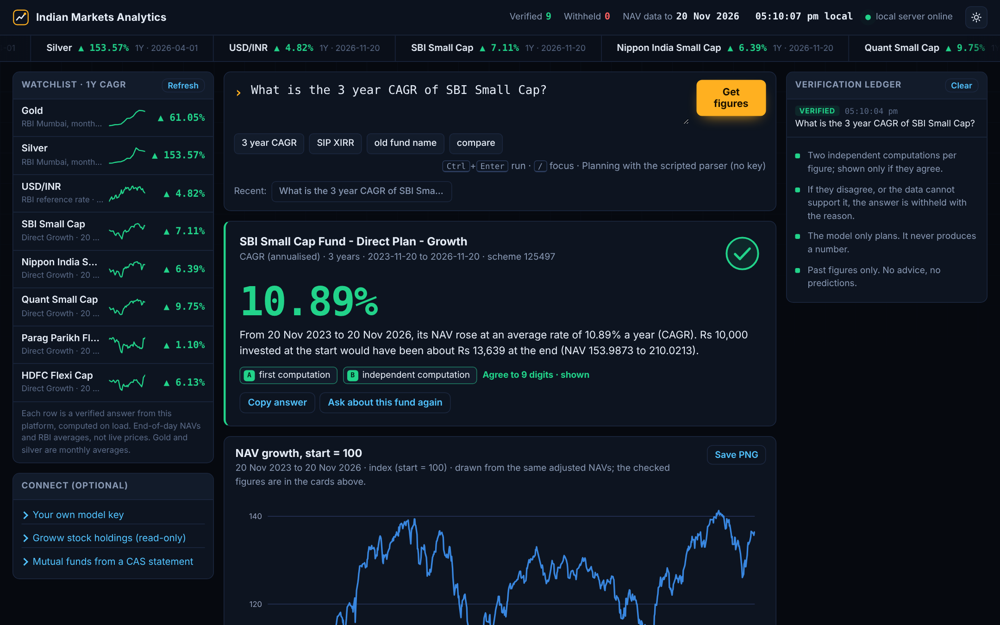
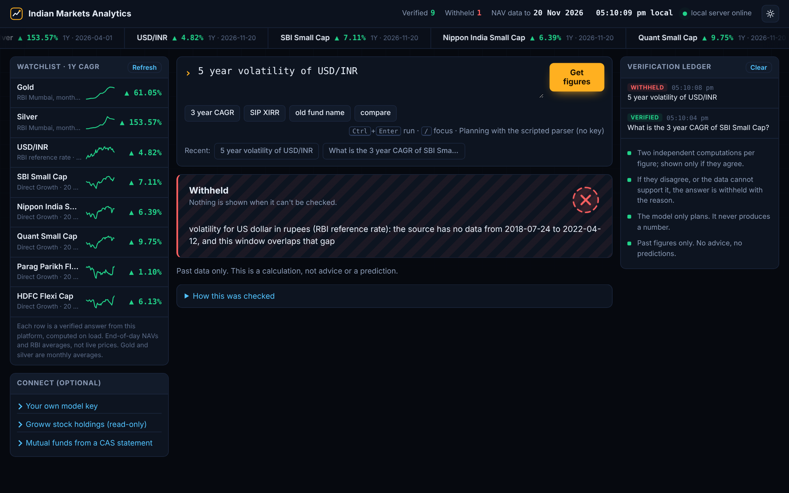
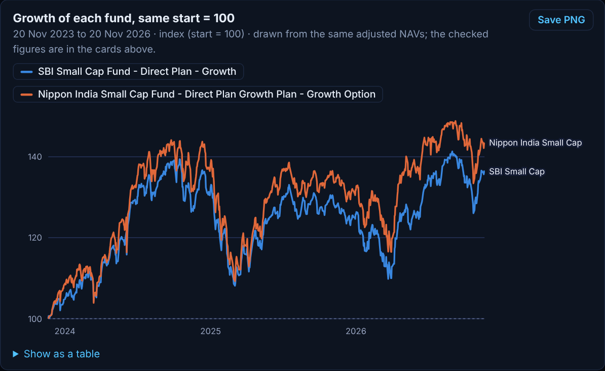
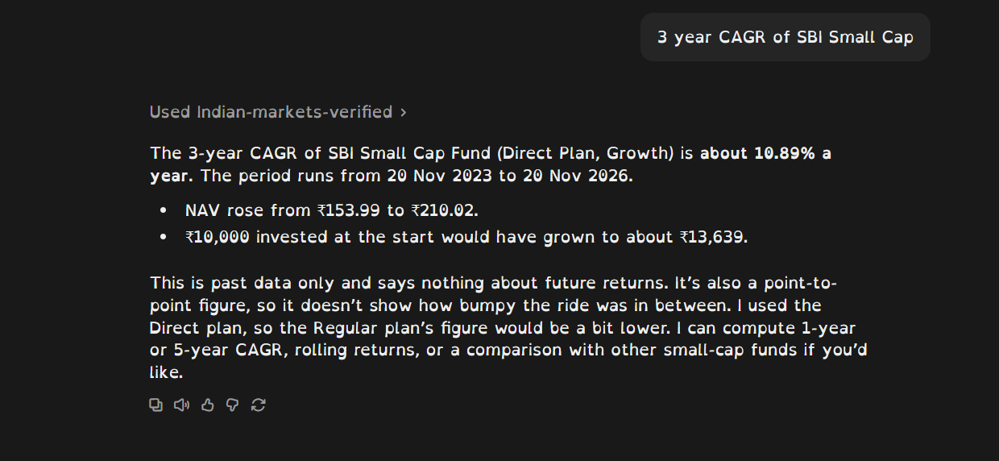

# Indian Markets Analytics Platform

An AI analyst for Indian mutual funds, gold, silver and USD/INR where **every number is computed by code, cross-checked by independent implementations, and verified, or the answer is withheld.** The language model only plans; it never writes a figure. Nothing here is investment advice, and nothing predicts returns. The one model-based figure, an opt-in volatility estimate, is shown separately and labelled as not verified.

> Status: working locally and published. Evidence for each claim is in `docs/`. Items marked UNVERIFIED have not been proven.

## What is verified, and what is not
| Claim | Evidence | Status |
|---|---|---|
| Numpy and DuckDB engines (and the Rust engine) agree on every figure | 40,169 figures, 0 disagreements (`docs/HARDENING.md`) | Measured in the development sandbox |
| CAGR matches published figures | HDFC funds, 12 of 12 at 2 decimals (`docs/ENGINE_RESULTS.md`) | Measured; one fund house, one date. Other metrics are not checked against outside sources |
| Tests, lint, types | 252 tests pass in the sandbox; ruff and mypy clean; CI green on GitHub | Measured |
| Runs on Windows | Full suite run on the author's machine earlier (227 passed, 9 skipped because Engine C is not built there) | Measured on one machine |
| MCP server in Claude Desktop | A new chat called the tool and returned a 3-year CAGR of 10.89% for a small-cap fund (`docs/MCP.md`) | Tried once, one machine |
| Local UI, screener, opt-in volatility estimate | Checked in a real Chrome on the author's machine | Checked by hand, not by automated browser tests |
| Reading a real CAS statement | Fixture tests only | **UNVERIFIED on a real PDF** |
| Groww holdings | Fixture tests only | **UNVERIFIED against the real API** |
| Rust engine on Windows | Built and tested only in the sandbox | **UNVERIFIED on Windows** |
| Volatility estimate (GARCH) | Shown separately, labelled not verified; its pre-registered test passed only modestly (`docs/LAB_1_VOLATILITY.md`) | Model estimate, not a verified figure |
| Reuse terms for AMFI-derived data | `docs/FEASIBILITY.md` | **UNVERIFIED** |

## What it looks like
A local, offline web terminal. The watchlist and ticker are verified answers computed when the page loads (end-of-day data, not live prices). Every figure shows both engines lighting up before it is shown; questions the data cannot support are withheld with the reason.



| Withheld, with the reason | Chart with hover, legend toggle and PNG export |
|---|---|
|  |  |

## Use it from Claude Desktop
The same verified engine runs as an MCP server, so an AI assistant calls it as a tool instead of searching the web. Here Claude Desktop answers a question by calling the server (the "Used" line above the answer); setup is in `docs/MCP.md`, or run `python add_to_claude_desktop.py`. This was tried once, on one machine.



## Why it is different
| Most finance chatbots | This project |
|---|---|
| The model writes the numbers | Code computes them; the model only turns a question into a plan |
| One implementation | Two independent engines (numpy; DuckDB SQL) plus an optional Rust engine, which must agree on values and dates |
| Wrong answers look confident | Disagreement, a data gap or a short window means the answer is **withheld with the reason** |
| "Trust me" | Hand-checked figures, mutation testing, pre-registered model evaluations |

## What it answers
Total return, CAGR, max drawdown, volatility, SIP XIRR, rolling returns, **Sharpe and Sortino ratios** (risk-free rate from RBI 91-day T-bill yields), for 1,772 mutual-fund schemes (AMFI NAVs), Mumbai gold and silver (RBI), and USD/INR (RBI). Compare several in one question, use the **SIP calculator** (what a past monthly plan would have become), or **screen** funds: rank every fund whose name contains some words (such as "small cap") by one measure, with every row passing the same agreement gate. Optional: read your own CAS statement (in memory only).

## How it works
```
question -> planner (LLM or rules) -> plan (JSON) -> validator (years/amounts must come from the question)
         -> resolve fund -> engine A (numpy) + engine B (DuckDB) [+ engine C (Rust)] -> compare every printed field
         -> VERIFIED answer   or   WITHHELD with a reason
```
Data checks run first: a manifest of SHA-256 hashes (the app refuses to start on a mismatch), pandera schemas, NAV outlier and scale-change detection with a recorded audit trail.

## Evidence
- **Three-engine agreement** over every series and window: 40,169 figures verified by all engines, 0 disagreements (`docs/HARDENING.md`, `scripts/run_agreement_abc.py`, `data/engine_agreement_abc.json`).
- **Tests:** 252, plus ruff and mypy clean, pip-audit clean.
- **Mutation testing** on the maths and the agreement gate: 88% of 1,746 mutants caught; it found two real bugs (`docs/HARDENING.md`).
- **Published-figure check:** HDFC CAGR matches 12 of 12 published figures (`docs/ENGINE_RESULTS.md`).
- **Planner evaluations:** locked sets, with failures kept on record. A first test of gold, silver and USD/INR questions failed (14 of 21), the prompt was fixed, and a new held-out set passed (15 of 17, 0 wrong answers): `docs/PLANNER_EVAL_V3.md`, `docs/PLANNER_EVAL_V4.md`.
- **Forecast Lab:** four pre-registered model experiments; one modest pass, three honest failures: `docs/LAB.md`.

## Quick start
    pip install -r requirements.txt
    python -m pytest -q
    cd src && python -m imap.server        # then open http://127.0.0.1:8765
A Groq key can be pasted on the page (kept in memory only); without one a scripted parser reads questions. Also: an **MCP server** for Claude Desktop (`docs/MCP.md`) (tried in Claude Desktop on Windows, one machine). Docker was dropped, never built (`docs/HARDENING.md`).

## Data
Built locally by the pipeline; sources: AMFI NAV archive, RBI (Handbook, reference rate archive, T-bill yields), optional NSE prices for personal use. **Reuse terms for AMFI-derived data are UNVERIFIED (`docs/FEASIBILITY.md`), and NSE data must not be published, so the repository does not include data files.** FBIL data is not used (its terms bar commercial use without permission).

## Known limits
- USD/INR has a hole from July 2018 to April 2022, so long dollar-rupee windows are withheld.
- Gold and silver are RBI monthly averages and end earlier than fund NAVs, so volatility and SIP are withheld for them, and comparisons across different end dates are refused.
- Sharpe and Sortino need T-bill yields, which start July 2015 and run about two months behind; those ratios are withheld before then and capped at the latest published yield.
- Engine C (Rust) has been built and tested only in the development sandbox; on Windows it is untested.
- Every claim above has a source in `docs/`; the full status list is `docs/STATUS.md`.
